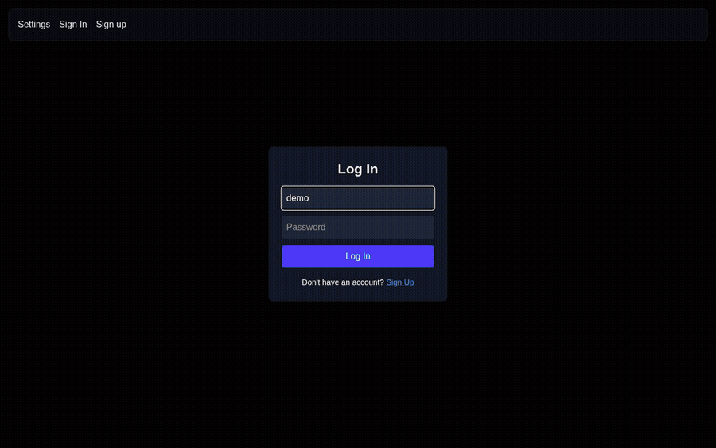
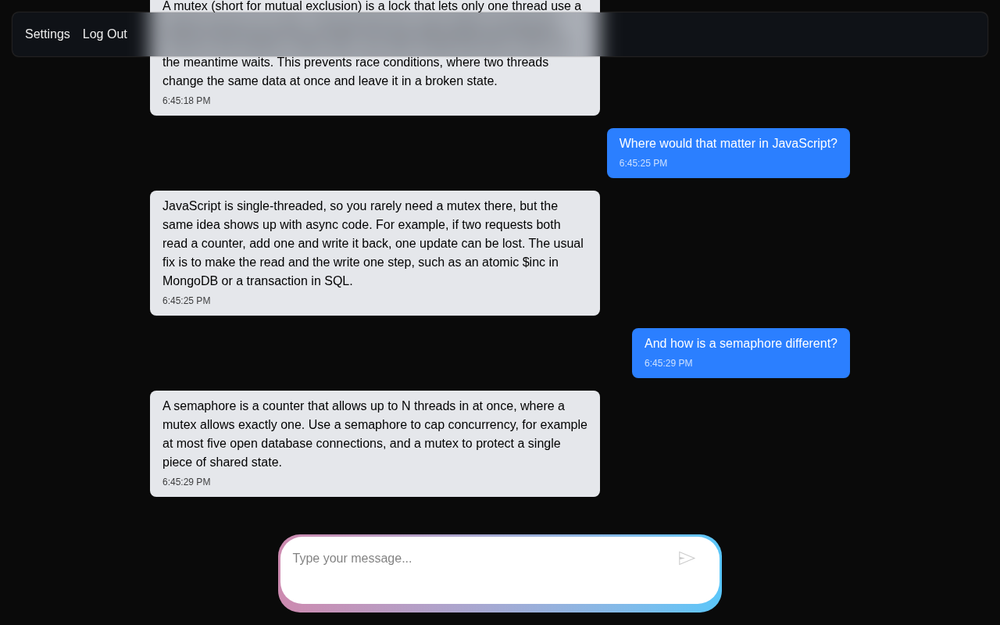

# chatbot

A chat app with sign-in and saved conversations. Replies stream in from Google Gemini through my own backend, [chatbot-backend](https://github.com/abbasnadir/chatbot-backend).



*Signing in, the saved conversation loading, and a follow-up reply streaming in. Recorded locally with MongoDB in Docker and a stand-in model in place of Gemini, so the reply text is canned.*

- **Next.js 16** with NextAuth (email and password, bcrypt hashes in MongoDB).
- The browser only talks to this app. Its `/api/chatbot` route signs a five-minute token for the caller (the user’s id, or `guest:<ip>`) and passes the backend’s event stream straight through, so replies appear as they are generated.
- Signed-in users get their history and their recent messages as context; guests can chat without either.
- Daily limits, history storage and the Gemini key all live in the backend.



*After a reload, the conversation comes back from the backend. Same local setup and stand-in model as above.*

## How it works

1. **Accounts.** `/signup` posts to `src/app/api/signup/route.ts`, which stores the user in MongoDB through Mongoose with a bcrypt hash. `/login` uses the NextAuth credentials provider in `src/app/auth.ts`.
2. **Sending a message.** `src/app/page.tsx` posts to `/api/chatbot`. That route asks `src/lib/backend.ts` who the caller is, signs an HS256 token for them with `jose` (issuer `chatbot-web`, audience `chatbot-backend`, five minutes), and calls the backend’s `POST /chat`.
3. **Streaming.** The backend answers with server-sent events (`delta`, then `done` or `error`). The route returns that body unchanged, and the page reads it frame by frame and appends each `delta` to the reply bubble.
4. **History.** When a user signs in, the page loads `/api/app-info`, which forwards to the backend’s `GET /chat/history?limit=100` (guests get a 401 from this route and start with an empty chat). The backend saves each turn itself once the reply is complete, so this app never writes chat messages.

## Run it locally

You need Node 22 or newer, pnpm, Docker for MongoDB, and [chatbot-backend](https://github.com/abbasnadir/chatbot-backend) running alongside.

1. Start MongoDB:

   ```bash
   docker run -d --name chatbot-mongo -p 27017:27017 mongo:7
   ```

2. Start chatbot-backend (see its README) on port 5000, pointed at the same MongoDB.

3. Create `.env.local` in this repo:

   | Variable | Purpose |
   | --- | --- |
   | `MONGODB_URI` | MongoDB connection string for accounts, e.g. `mongodb://localhost:27017/chatbot-web` |
   | `AUTH_SECRET` | NextAuth secret (`openssl rand -base64 32`) |
   | `AUTH_TRUST_HOST` | Set to `true` when running `pnpm start` anywhere other than Vercel |
   | `BACKEND_URL` | Where chatbot-backend runs, e.g. `http://localhost:5000` |
   | `BACKEND_JWT_SECRET` | The same secret as in chatbot-backend (at least 32 characters) |

4. Install and run:

   ```bash
   pnpm install
   pnpm build
   pnpm start      # http://localhost:3000
   ```

   `pnpm dev` runs the development server instead.

Open the app, sign up, sign in, and send a message. Without signing in you can still chat as a guest, but nothing is saved.

## Project structure

```text
src/
  app/
    page.tsx                    chat screen: sends messages, reads the event stream, loads history
    login/, signup/             account pages
    auth.ts, auth.config.ts     NextAuth with a credentials provider
    api/chatbot/route.ts        forwards a message to the backend and streams the reply back
    api/app-info/route.ts       forwards history requests (GET and DELETE) for signed-in users
    api/signup/route.ts         creates an account
  lib/backend.ts                signs the short-lived token and calls the backend
  db/                           Mongoose connection and the User model
  components/                   navbar and auth context
docs/                           README images
```
